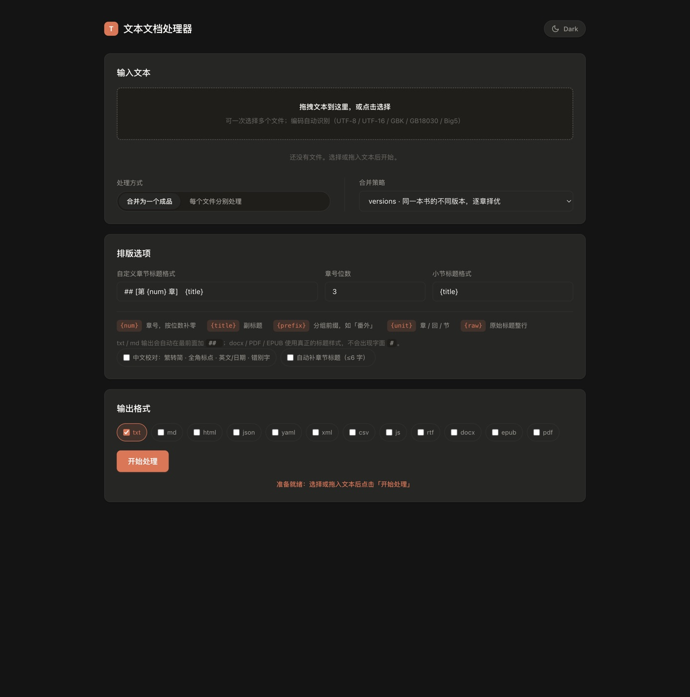

<h1 align="center">fin-doc-pipeline</h1>

<p align="center"><b>Dependency-free text pipeline for Chinese and mixed-language documents</b><br>
encoding detection · dedupe &amp; merge · Simplified Chinese proofreading · typesetting · 12 formats</p>

<p align="center">
  <a href="https://github.com/0xFin/fin-doc-pipeline/actions/workflows/ci.yml"></a>
  <a href="https://www.npmjs.com/package/fin-doc-pipeline"></a>
  <a href="https://www.npmjs.com/package/fin-doc-pipeline"></a>
  <a href="https://github.com/0xFin/fin-doc-pipeline/releases"></a>
  <a href="https://0xFin.github.io/fin-doc-pipeline/"></a>
  <a href="LICENSE"></a>
  <a href="package.json"></a>
</p>

<p align="center"><a href="README.md">简体中文</a> · <b>English</b></p>

---

> Turn messy real-world text into a clean, consistently typeset document, ready to read or publish.

```sh
npm i -g fin-doc-pipeline

fin-doc-pipeline inspect book.txt                        # encoding, structure, issues
fin-doc-pipeline merge vol1.txt vol2.txt -o book.txt     # dedupe and merge
fin-doc-pipeline format book.txt --proofread -o clean.txt # Chinese proofreading
fin-doc-pipeline convert clean.txt --to epub,docx,pdf    # export
```

**Live demo: <https://0xFin.github.io/fin-doc-pipeline/>** · or open `index.html` from disk; it runs fully offline.

## Why this exists

- **Scored encoding detection**: every candidate is decoded and scored, so one bad byte in a 200 KB GBK novel cannot silently turn the whole book into mojibake.
- **Chapter identity = (group, number)**: `番外第001章` no longer collides with the main-story `第001章`.
- **Zero dependencies, fully offline, deterministic**: Node built-ins only; same input, same output.
- **Nothing is dropped silently**: every discarded paragraph, file or chapter version is written to a side report.

## Features

| | |
| :-- | :-- |
| 🔍 | **Encoding** UTF-8 (BOM) / UTF-16 / GBK / GB18030 / Big5, scored instead of first-match |
| 🧱 | **Structure** chapters, sections, volumes, specials, prefixed groups; Markdown, DOCX, EPUB and HTML levels understood |
| 🧹 | **Three-level dedupe** identical files, same-numbered chapters, repeated paragraphs |
| 🔀 | **Two merge modes** `versions` (best copy per chapter) and `concat` (several books) |
| ✅ | **Proofreading** twenty structural rules plus nine Simplified Chinese rules |
| 🖋 | **Typesetting** title templates, indentation, blank lines, reflow, punctuation |
| 📦 | **20+ inputs, 12 outputs**, any combination in one command |
| 🤖 | **Agent friendly** `--json` and `--dry-run`, ships `SKILL.md` |
| 🛡 | **Safe by default** sources are never deleted without two explicit flags |

## Quick start

### 1. Inspect

```sh
fin-doc-pipeline inspect book.txt
```

```text
■ book.txt
   size   2.8 MB   encoding GBK (100%)
   layout chapters 293   sections 12   specials 1   volumes 3   paragraphs 15272   chars 802531
   lint   errors 0   warnings 10   hints 0
```

### 2. Merge volumes

```sh
fin-doc-pipeline merge vol1.txt vol2.txt vol3.txt -o book.txt
```

Chapters present in several files are compared and the most complete copy wins; every decision is written to `.report.md`.

### 3. Proofread and export

```sh
fin-doc-pipeline format book.txt --proofread -o clean.txt
fin-doc-pipeline convert clean.txt --to epub,docx,pdf
```

## Chinese proofreading

```sh
fin-doc-pipeline format book.txt --proofread -o clean.txt
fin-doc-pipeline format book.txt --simplify      # characters only
fin-doc-pipeline format book.txt --auto-titles   # missing titles only
fin-doc-pipeline check book.txt                  # report only
```

| Rule | What it does |
| --- | --- |
| `C001` | Traditional → Simplified; 乾 / 著 / 瞭 / 藉 corrected by context (乾隆, 著作, 瞭望, 慰藉 kept) |
| `C002` | `「」『』` → `“”‘’`; half-width `, ; : ? ! ( )` next to Chinese become full-width |
| `C003` | repeated identical punctuation collapses to one; `……` is preserved |
| `C004` | numbers and English go half-width, words are capitalised, known acronyms upper case |
| `C005` | dates unify to `yyyy-MM-dd HH:mm` |
| `C006` | built-in list of common misspellings (按耐→按捺, 既使→即使 …) |
| `C007` | doubled particles and words (的的 → 的) |
| `C008` | untitled chapters get a title extracted from the whole section: terms are scored by frequency, paragraph coverage and position, and wording shared by every chapter is down-weighted; when nothing repeats (narrative) the opening clause is used. At most 6 characters |
| `C009` | wording hints (大约…左右, 原因是…造成的), reported not rewritten |
| `C010` | one space between Chinese and Latin letters: 中文English → 中文 English; digits stay untouched |
| `C011` | closing punctuation at the start of a paragraph, usually a hard-wrap artifact; a dialogue line starting with “ is fine. Reported only |
| `C012` | one space between a number and a unit: 5kg → 5 kg; percent and ℃ stay as they are |
| `C013` | nested book titles / parentheses should switch to 〈〉 or another bracket level. Reported only |
| `C014` | a second “ before the first closes should be ‘ ’ inside. Reported only |

`check` also inspects the raw text layer (BOM, line endings, blank-line runs,
trailing spaces, tab indentation) and `check --fix` repairs all of it.

Deterministic and idempotent: a second run changes nothing. Wording problems are
reported rather than guessed, so correct sentences are never rewritten.

## Formats

| Kind | Input | Output |
| :-- | :-- | :-- |
| Plain text | `txt` `md` `rst` `ini` `log` `srt` `tex` | `txt` `md` |
| Structured | `json` `yaml` `xml` `csv` `js` `ts` | `json` `yaml` `xml` `csv` `js` |
| Markup | `html` `rtf` | `html` `rtf` |
| Office / ebooks | `docx` `epub` | `docx` `epub` |
| Paged | `pdf` | `pdf` (A5, automatic page numbers, selectable CJK) |

## Install

Requires Node.js 18+. **No third-party dependencies**, no `npm install` needed. Pick one of four ways.

### 1. npm (recommended)

```sh
npm i -g fin-doc-pipeline
```

Provides `fin-doc-pipeline` and the short alias `fdp`; upgrade with `npm i -g fin-doc-pipeline@latest`.

### 2. From source

```sh
git clone https://github.com/0xFin/fin-doc-pipeline.git && cd fin-doc-pipeline && ./install.sh
```

For hacking on the code or avoiding npm. `install.sh` copies the checkout into `~/.dsh/skills/fin-doc-pipeline` and keeps the source tree, so `node src/cli.mjs` also works.

### 3. As an agent skill

```sh
fin-doc-pipeline install-skill
```

Copies the package into `~/.dsh/skills/fin-doc-pipeline`; the agent picks it up within seconds. Requires step 1 first. Use `--dest` for another skills root.

### 4. Symlink mode (development)

```sh
fin-doc-pipeline install-skill --link
```

Installs a symlink instead of a copy, so edits in the checkout apply immediately without reinstalling.

## Commands

| Command | Purpose |
| :-- | :-- |
| `inspect` | read-only report: encoding, structure, chapter numbers, issues |
| `format` | clean and typeset one file |
| `merge` | de-duplicate and merge several files (`--merge-mode versions` / `concat`) |
| `check` | audit; `--fix` writes a repaired copy, `--fix-rules` picks rules |
| `convert` | convert with `--to txt,md,html,json,yaml,xml,csv,js,rtf,docx,epub,pdf` |
| `install-skill` | install as an agent skill |

## Title templates

```sh
fin-doc-pipeline format book.txt --title "[第 {num} 章]" --title-sep "　"
fin-doc-pipeline format book.txt --title "{raw}"          # keep the original line
fin-doc-pipeline format book.txt --heading-prefix "§ "   # decorate every heading
```

| Placeholder | Meaning |
| :-- | :-- |
| `{num}` | chapter number, zero padded to `--num-width` (default 3) |
| `{num:4}` | custom padding |
| `{title}` | subtitle |
| `{prefix}` | group prefix such as 番外 |
| `{unit}` | unit: 章 / 回 / 节 |
| `{raw}` | original heading line |

Each heading kind has its own template (`--title`, `--section-title`,
`--volume-title`, `--special-title`, `--group-title`); see `--help`.

## Heading detection

Rules run in order, first match wins: `manual` → `markdown` → `numbered-cn` →
`numbered-en` → `cn-list` → `ordered` → `bracket` → `special` → `heuristic`.

| Rule | Matches |
| :-- | :-- |
| `manual` | lines listed in `--headings-file` (authoritative) |
| `markdown` | `#` … `######` |
| `numbered-cn` | 第12章 / 第十二回 / 第3节 / 第一卷 |
| `numbered-en` | Chapter IV / Part II / Section 3 |
| `cn-list` | 一、总则 / （三） |
| `ordered` | 1. 范围 / A. 简介 |
| `bracket` | [楔子] 【后记】 |
| `special` | 前言 / 尾声 / 番外 |
| `heuristic` | short line between blank lines (opt in) |

```sh
fin-doc-pipeline format book.md --rules markdown,numbered-en
fin-doc-pipeline format book.md --heading-regex "^◆ (.+)$"
fin-doc-pipeline format book.md --md-title-level 1 --md-chapter-level 2 --md-section-level 3
```

## Configuration

Put `fin-doc-pipeline.config.json` in the working directory (or pass `--config`);
command line flags always win. Full example in
[`examples/fin-doc-pipeline.config.json`](examples/fin-doc-pipeline.config.json).

```json
{
  "format":  { "chapterTitle": "[第 {num} 章]", "titleSeparator": "　", "indent": "　　" },
  "merge":   { "mode": "versions", "pick": "longest" },
  "output":  { "encoding": "utf-8", "bom": false, "eol": "lf" },
  "convert": { "includeDocTitle": false },
  "safety":  { "cleanSources": false, "hardDelete": false }
}
```

## Web version

The browser build runs entirely locally: encoding detection, HTML/RTF markup
removal, raw-text repairs, parsing, merging, proofreading, typesetting, the
check report and all twelve export formats are inlined into one `index.html`,
so it also works opened from disk, offline.

[](https://0xFin.github.io/fin-doc-pipeline/)

- **Live**: <https://0xFin.github.io/fin-doc-pipeline/>
- **Offline**: `index.html` (~200 KB), copy anywhere and double click
- **Rebuild**: edit `web/index.template.html` or `web/app.mjs`, then `npm run build`

> The browser build takes text inputs (txt / md / html / rtf / json / csv…);
> HTML and RTF are stripped of markup first. DOCX / EPUB / PDF *input* needs
> decompression, so use the CLI; all twelve export formats work in the browser.
> Output can be UTF-8 / UTF-16LE / UTF-16BE / Latin-1 with optional BOM and
> CRLF; GBK, Big5 and GB18030 need the system iconv and are CLI only.

## Project layout

```text
src/rules.mjs        heading detection rule engine
src/parser.mjs       document tree (chapters / sections / volumes / specials)
src/typography.mjs   cleaning, title templates, assembly
src/merge.mjs        file / chapter / paragraph dedupe
src/lint.mjs         rules and safe repairs
src/chinese.mjs      Simplified Chinese rules and chapter titles
src/data/t2s.mjs     traditional to simplified table (CLDR)
src/encoding.mjs     scored encoding detection
src/loaders/         docx / epub / pdf / html / rtf / text input
src/formats/         docx / epub / pdf / rtf / json / yaml / xml / csv / js output
src/zip.mjs          dependency-free ZIP reader and writer
src/cli.mjs          command line interface
web/                 browser sources (built into the single file index.html)
test/run.mjs         dependency-free test suite (109 checks)
```

## Roadmap

- [x] inspect / format / merge / check / convert / install-skill
- [x] 12 output formats, 20+ input formats
- [x] configurable heading rules, chapter levels, Markdown level mapping
- [x] Simplified Chinese proofreading and generated chapter titles
- [x] offline single-file web build and GitHub Pages demo
- [ ] automatic double-encoding recovery (iconv)
- [ ] optional cover image, PDF headers and footers

## Contributing and license

Bug reports, format requests and new detection rules are welcome. The project
stays dependency-free on purpose. See [CONTRIBUTING.md](CONTRIBUTING.md) and
[CHANGELOG.md](CHANGELOG.md). MIT, see [LICENSE](LICENSE).
