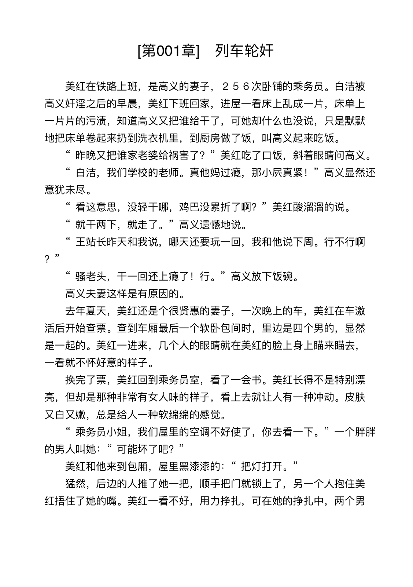

<h1 align="center">fin-doc-pipeline</h1>

<p align="center"><b>Dependency-free text pipeline: detect encoding · dedupe &amp; merge · lint · typeset · convert</b></p>

<p align="center">
  <a href="https://github.com/0xFin/fin-doc-pipeline/actions/workflows/ci.yml"></a>
  <a href="https://www.npmjs.com/package/fin-doc-pipeline"></a>
  <a href="https://www.npmjs.com/package/fin-doc-pipeline"></a>
  <a href="LICENSE"></a>
  <a href="package.json"></a>
</p>

<p align="center"><a href="README.md">简体中文</a> · <b>English</b></p>

---


[](https://github.com/0xFin/fin-doc-pipeline/actions/workflows/ci.yml) [](https://www.npmjs.com/package/fin-doc-pipeline)

A dependency-free command line pipeline for messy real-world text: detect the
encoding, de-duplicate and merge several sources, audit the content, typeset it
consistently, and export it as plain text, Markdown, HTML, RTF, Word (DOCX) or
EPUB.

```sh
fin-doc-pipeline inspect book.txt
fin-doc-pipeline merge part1.txt part2.txt part3.txt -o book.txt
fin-doc-pipeline check book.txt --fix -o fixed.txt
fin-doc-pipeline convert book.txt --to md,html
```

## Why another text tool

Most "merge and clean" scripts try encodings in order and take the first that
does not throw. That fails badly: one invalid byte deep inside a 200 KB GBK
novel makes the GBK decoder throw, the Big5 decoder happily accepts the same
bytes, and the whole book silently becomes mojibake that still *looks* like
Chinese.

fin-doc-pipeline decodes every candidate and scores the result by how much it looks
like real prose: high-frequency character hits, with penalties for replacement
characters and private-use glyphs. Chapter identity is `(group, number)`, so
`番外第001章` no longer collides with the main story chapter `第001章`.

## Preview of the PDF output



## Web version

The browser build runs entirely locally, with no backend and no uploads.

**`index.html` works opened straight from disk.** Encoding detection, parsing,
merging, typesetting and all twelve export formats are inlined into that one
file, so it runs offline — from a USB stick, with no server and no
`start.command`. Drop it into a browser tab and bookmark the `file://` URL.

`index.html` is generated: the markup and styles live in
`web/index.template.html`, the behaviour in `web/app.mjs`. Edit those and run
`npm run build` to inline them again.

A local server is only needed for a stable `http://` address (for example to
open the page from a phone on the same network) or for development:

```sh
git clone https://github.com/0xFin/fin-doc-pipeline.git
cd fin-doc-pipeline
./start.command                 # macOS: double clicking works too
python3 -m http.server 8000     # or manually
```

> The browser build only takes text inputs (txt / md / html / json / csv …).
> DOCX / EPUB / PDF input needs decompression, so use the CLI for those; all
> twelve export formats work in the browser.
## Features

- **Encoding detection** UTF-8 (BOM), UTF-16LE/BE, GBK, GB18030, Big5, ASCII
- **Document model** chapters, volumes, special sections, prefixed groups
  (`番外第001章`), Markdown headings (`## [第001章]`)
- **Three-level dedupe** identical files, same-numbered chapters across files,
  duplicated paragraphs inside a chapter
- **Two merge modes** `versions` (one book, keep the best copy) and `concat`
  (several books, keep everything)
- **Lint and repair** twenty textual and structural rules with safe auto-fixes, plus Simplified Chinese proofreading (traditional → simplified, full-width punctuation, English casing, ISO dates, common typos, generated chapter titles)
- **Typesetting** title templates, indentation, blank-line policy, optional
  reflow and punctuation normalisation
- **Export** plain text, Markdown, HTML, RTF, DOCX, EPUB 3 and PDF, any
  combination in one command
- **Import** txt, Markdown, HTML, RTF, DOCX, EPUB, PDF, JSON, YAML, XML, CSV and
  JavaScript; DOCX, EPUB and PDF also yield title and author metadata
- **Structured export** the parsed document as JSON, YAML, XML, CSV or a JS module
- **Heading detection** as a configurable rule pipeline: markdown, Chinese and English
  numbering, 一、 lists, bracketed sections, custom regex, manual lists, optional heuristic
- **Chapters and sections** with separate templates and correct nesting in every output
- **Custom titles** per heading kind with {num}, {num:N}, {title}, {prefix}, {unit}, {raw}
- **Agent friendly** every command supports `--json` and `--dry-run`
- **Safe by default** sources are never deleted without two explicit flags, and
  removal goes to the trash rather than `rm`

## Chinese proofreading

```sh
fin-doc-pipeline format book.txt --proofread -o book.out.txt
fin-doc-pipeline format book.txt --simplify      # characters only
fin-doc-pipeline format book.txt --auto-titles   # missing titles only
```

| Rule | What it does |
| --- | --- |
| C001 | Traditional characters become Simplified; 乾/著/瞭/藉 are corrected by context (乾隆, 乾坤, 著作, 瞭望, 慰藉 kept) |
| C002 | 「」『』 → “”‘’; half-width punctuation and parentheses next to Chinese become full-width |
| C003 | repeated identical punctuation collapses to one; `……` is left alone |
| C004 | numbers and English go half-width, words are capitalised, known acronyms and product names upper case (KFC, USD, USDT) |
| C005 | dates unify to `yyyy-MM-dd HH:mm` (`2024年3月5日 12:30` → `2024-03-05 12:30`) |
| C006 | built-in list of common misspellings (按耐→按捺, 既使→即使 …) |
| C007 | doubled particles and words (的的 → 的) |
| C008 | a chapter without a title gets one generated from its first paragraph, at most 6 characters |
| C009 | wording hints (大约…左右, 原因是…造成的, 通过…使…), reported not rewritten |

The pass is deterministic and idempotent. `check --fix-rules C001,C002` runs
individual rules; `check` reports them without touching the file.

## Install

```sh
git clone https://github.com/0xFin/fin-doc-pipeline.git
cd fin-doc-pipeline
npm test        # 88 checks, no dependencies
node src/cli.mjs --help
```

To expose the command:

```sh
npm link                         # provides fin-doc-pipeline and fdp
npm install -g .                 # or install globally from this checkout
npm install -g fin-doc-pipeline  # once published to the registry
```

To use it as an agent skill, install it into a scanned skills root. After a
global npm install:

```sh
fin-doc-pipeline install-skill                    # -> ~/.dsh/skills/fin-doc-pipeline
fin-doc-pipeline install-skill --dest ~/.claude/skills
fin-doc-pipeline install-skill --link             # symlink, edits apply live
fin-doc-pipeline install-skill --uninstall
```

> The agent picks the skill up within seconds, but the web UI caches the `/` menu
> per session: **reload the page** (Cmd+R / Ctrl+R) before it shows up there.

Or just copy the directory: `cp -R . ~/.dsh/skills/fin-doc-pipeline`. DeepSeek
Harness picks it up within a few seconds, without restarting the app or opening
a new session. The bundled `SKILL.md` follows the Agent Skills convention and
works with any agent that reads it.

> Note: the frontmatter must be valid YAML. An unquoted description containing
> `: ` silently invalidates the whole skill.

## Usage

### Inspect first

```
$ fin-doc-pipeline inspect book.txt
■ book.txt
   编码   GBK（置信度 100%）
   结构   章节 293   特殊篇目 1   卷 3   段落 15272   字数 802531
   检查   错误 0   警告 10   提示 0
```

### Merge volumes of one book

```sh
fin-doc-pipeline merge volume1.txt volume2.txt volume3.txt -o book.txt
```

Chapters present in more than one file are compared and the most complete copy
wins. A Markdown report next to the output records every decision; the book
itself stays clean.

### Concatenate different books

```sh
fin-doc-pipeline merge a.txt b.txt --merge-mode concat --renumber -o collection.txt
```

### Typeset

```sh
fin-doc-pipeline format manuscript.txt -o out.txt \
  --title "[第{num}章]" --indent "　　" --blank-before 1 --blank-after 1
```

### Export

```sh
text-forge convert book.txt --to md,html --meta-author "某作者"
text-forge convert book.txt --to epub,docx
text-forge merge v1.txt v2.txt -o book.txt --to epub
```

Output formats: `txt`, `md`, `html`, `json`, `yaml`, `xml`, `csv`, `js`, `rtf`,
`docx`, `epub`, `pdf`. The DOCX, EPUB and PDF writers
live in this repository on top of Node's `zlib`, so no third party packages are
involved. DOCX gets centred chapter headings, justified first-line-indented
body text and a page break before each chapter; EPUB gets a navigation document,
an NCX fallback and one XHTML file per chapter. PDF is A5 with centred chapter
headings, justified text and automatic page numbers; it uses the standard
`UniGB-UCS2-H` CJK font mechanism, so viewers substitute a system Song/Ming
font and text stays selectable. None of them embeds a cover image.

Structured formats (`json`, `yaml`, `xml`, `csv`, `js`) emit the parsed model:
metadata, front matter, and one entry per chapter with its paragraphs.
## Heading detection

Rules run in order; the first match wins: `manual, markdown, numbered-cn, numbered-en,
cn-list, ordered, bracket, special, heuristic`.

```sh
# only some rules
text-forge format book.md --rules markdown,numbered-en

# a rule of your own (|| separates alternatives)
text-forge format book.md --heading-regex '^◆ (.+)

```sh
text-forge format book.txt --title '第{num}章 {title}' --title-sep ' · '
text-forge format book.txt --title '{num:4} | {title}' --num-width 3
text-forge format book.txt --title '{raw}'      # keep headings as written
text-forge format book.txt --group-title '{prefix} {num} {title}'
```

Placeholders: `{num}`, `{num:N}`, `{title}`, `{prefix}`, `{unit}`, `{raw}`.
When a template omits `{title}`, the subtitle is appended after `--title-sep`.

Output files never overwrite their source: on a name collision a `.out` marker
is inserted (`book.txt` -> `book.out.txt`).

## Example configuration

A ready to use Chinese novel preset lives in
[`examples/fin-doc-pipeline.config.json`](examples/fin-doc-pipeline.config.json).
Copy it into your working directory as `fin-doc-pipeline.config.json` and every
command picks it up automatically.

## Configuration

Create `fin-doc-pipeline.config.json` in the working directory, or pass `--config`.
Command line flags win over the file.

```json
{
  "meta":   { "title": "", "author": "", "language": "zh-CN" },
  "format": { "chapterTitle": "[第{num}章]", "indent": "　　", "blankBeforeTitle": 1 },
  "merge":  { "mode": "versions", "pick": "longest", "paragraphDedupe": true },
  "output": { "encoding": "utf-8", "bom": false, "eol": "lf" },
  "safety": { "cleanSources": false, "hardDelete": false }
}
```

## Design principles

1. **Never lose content silently.** Every dropped paragraph, file or chapter
   version is recorded in a report.
2. **Read-only by default.** Inspect and dry-run first; writes need an output
   path; deletions need two flags.
3. **Keep the report out of the book.** Provenance is useful to you, not to a
   reader.
4. **Zero dependencies.** Node built-ins only.
5. **Deterministic.** Same input, same output, no network, no timestamps in the
   book.

## Compatibility

- Node.js 18 or newer
- macOS, Linux and Windows (deletion uses the system trash where available)
- Non-UTF-8 output needs `iconv` on the PATH; UTF-8 output does not

## Roadmap

- [x] inspect / format / merge / check / convert
- [x] txt / md / html / rtf / docx / epub export
- [x] table of contents in DOCX and EPUB
- [x] docx / epub as input
- [x] pdf export
- [x] pdf page numbers
- [x] json / yaml / xml / csv / js export
- [x] html / rtf / pdf input
- [x] configurable heading rules, sections and Markdown level mapping
- [ ] double-encoded mojibake repair via `iconv`
- [ ] optional cover image
- [ ] running headers in PDF

## Contributing

Bugs, format requests and heading rules are all welcome. The project has no
dependencies and that is not going to change, so contributions must use Node
built-ins only. See [CONTRIBUTING.md](CONTRIBUTING.md) and
[CHANGELOG.md](CHANGELOG.md).

## License

MIT. See [LICENSE](LICENSE).

# authoritative list, one heading per line
text-forge format book.md --headings-file headings.txt --rules manual

# my H1 is the book title, H2 a chapter, H3 a section
text-forge format book.md --md-title-level 1 --md-chapter-level 2 --md-section-level 3

# guess based detection, opt in
text-forge format book.md --heuristic-headings
```

`第3节`, `### heading`, `一、` and `1.` become **sections**: they stay inside their
chapter, never force a page break, get their own template and are nested in
JSON/YAML/XML output. Headings without a number use `--unnumbered-title`
(default `{title}`) instead of inventing a chapter number.

## Custom chapter titles

```sh
text-forge format book.txt --title '第{num}章 {title}' --title-sep ' · '
text-forge format book.txt --title '{num:4} | {title}' --num-width 3
text-forge format book.txt --title '{raw}'      # keep headings as written
text-forge format book.txt --group-title '{prefix} {num} {title}'
```

Placeholders: `{num}`, `{num:N}`, `{title}`, `{prefix}`, `{unit}`, `{raw}`.
When a template omits `{title}`, the subtitle is appended after `--title-sep`.

Output files never overwrite their source: on a name collision a `.out` marker
is inserted (`book.txt` -> `book.out.txt`).

## Configuration

Create `fin-doc-pipeline.config.json` in the working directory, or pass `--config`.
Command line flags win over the file.

```json
{
  "meta":   { "title": "", "author": "", "language": "zh-CN" },
  "format": { "chapterTitle": "[第{num}章]", "indent": "　　", "blankBeforeTitle": 1 },
  "merge":  { "mode": "versions", "pick": "longest", "paragraphDedupe": true },
  "output": { "encoding": "utf-8", "bom": false, "eol": "lf" },
  "safety": { "cleanSources": false, "hardDelete": false }
}
```

## Design principles

1. **Never lose content silently.** Every dropped paragraph, file or chapter
   version is recorded in a report.
2. **Read-only by default.** Inspect and dry-run first; writes need an output
   path; deletions need two flags.
3. **Keep the report out of the book.** Provenance is useful to you, not to a
   reader.
4. **Zero dependencies.** Node built-ins only.
5. **Deterministic.** Same input, same output, no network, no timestamps in the
   book.

## Compatibility

- Node.js 18 or newer
- macOS, Linux and Windows (deletion uses the system trash where available)
- Non-UTF-8 output needs `iconv` on the PATH; UTF-8 output does not

## Roadmap

- [x] inspect / format / merge / check / convert
- [x] txt / md / html / rtf / docx / epub export
- [x] table of contents in DOCX and EPUB
- [x] docx / epub as input
- [x] pdf export
- [x] pdf page numbers
- [x] json / yaml / xml / csv / js export
- [x] html / rtf / pdf input
- [ ] double-encoded mojibake repair via `iconv`
- [ ] optional cover image
- [ ] running headers in PDF

## License

MIT. See [LICENSE](LICENSE).